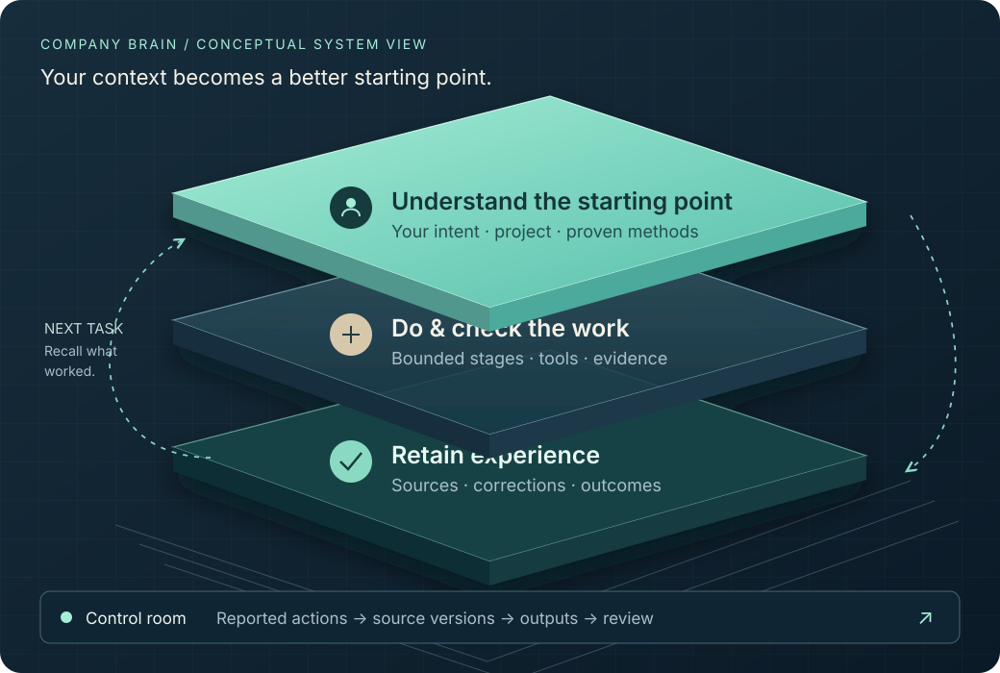

# SYN · Company Brain MVP10

**An open-source framework for context continuity, reusable methods and inspectable human–AI work.**

[Open the presentation](https://lexspin.github.io/syn-company-brain-mvp10/presentation/) · [Explore the interactive example](https://lexspin.github.io/syn-company-brain-mvp10/presentation/papers/Company-Brain-Control-Room.html) · [Business plan](presentation/business-plan/SYN-BUSINESS-PLAN.md) · [3D dependency map](https://lexspin.github.io/syn-company-brain-mvp10/presentation/business-plan/SYN-3D-MAP.html)



This independent public project starts from the **MVP10-Presentation** branch, reviewed 13 October 2026. It combines SYN-owned framework source, a browser presentation, the business plan and linked research. Anyone can clone, fork, adapt and propose changes under the [MIT licence](LICENSE), subject to the [third-party notices](NOTICE.md).

## Explore

The hosted presentation runs in your browser. Its animated control room uses a clearly labelled illustrative sequence; it does not call a model or connect to the founder's machine. The linked source implements local framework mechanisms. A full operational deployment is a separate integration task.

| Start with | Purpose |
|---|---|
| [Presentation](https://lexspin.github.io/syn-company-brain-mvp10/presentation/) | Visual overview and development horizons |
| [Business plan PDF](presentation/business-plan/SYN-BUSINESS-PLAN.pdf) | Commercial proposition, dependencies, annexes and references |
| [Research collection](presentation/papers/README.md) | Framework and dated development papers |
| [AI review guide](presentation/AI-REVIEW.md) | Trace claims into source and evidence |
| [Public release assessment](docs/PUBLIC-RELEASE.md) | What ships, checks, exclusions and limits |

## Run locally

```sh
git clone https://github.com/lexspin/syn-company-brain-mvp10.git
cd syn-company-brain-mvp10
python -m http.server 8765 --bind 127.0.0.1
```

Open http://127.0.0.1:8765/presentation/. This address refers to **your own computer**. The shared website uses GitHub Pages and does not expose the founder's computer.

Run the portable framework example with Python 3.11 or newer:

```sh
python examples/portable_brain.py
python -m unittest discover -s evaluations -p test_control_room.py -v
python -m unittest discover -s evaluations -p test_loop_audit.py -v
node evaluations/control-room.test.js
```

The example creates an isolated temporary Brain, versions a synthetic project and memory, reads them back, and then removes only its temporary directory. It uses no model, network, credentials or private data. Node 20+ is required for the JavaScript check.

## The framework

Intention → relevant context → selected method → execution → evidence check → retained outcome. The first-party modules under `app/` expose local record storage, bounded context, task contracts, activity projection and review mechanisms. See [architecture](docs/ARCHITECTURE.md) and [control room](docs/CONTROL-ROOM.md).

Some retained integration modules expect a separately licensed dashboard or a configured native host. They are source for inspection and extension, not an installed public service. Owner-specific import/seed scripts are excluded. The portable example and browser presentation are the supported entry points for this public edition.

## Direction

The current personal prototype explores continuity across tasks. Team knowledge requires enforced role permissions and disclosure controls. The proposed cooperative ecosystem requires tenant isolation, delegated mandates, accountable mediation, interoperability and sustainable service economics. These are development dependencies, not shipped cloud services or certified standards. Figures and revenue examples in the plan are labelled assumptions.

## Contribute

Open an issue for a correction or proposal, fork this repository, and submit a pull request. Documentation, research corrections, accessibility improvements and tested framework changes are welcome. [Contribution guide](CONTRIBUTING.md) · [Governance](GOVERNANCE.md) · [Security](SECURITY.md) · [Conduct](CODE_OF_CONDUCT.md)
