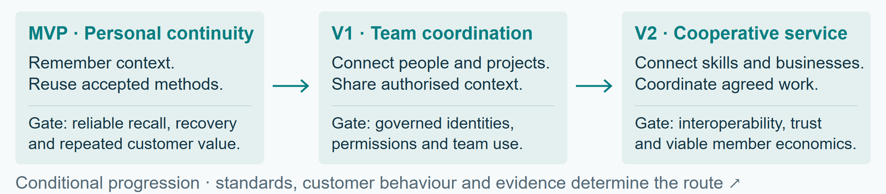
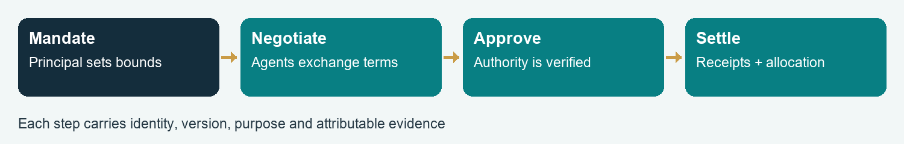
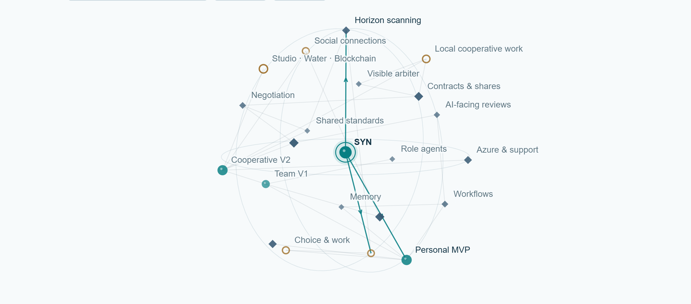
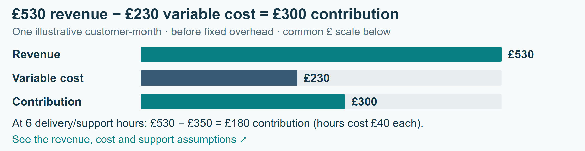
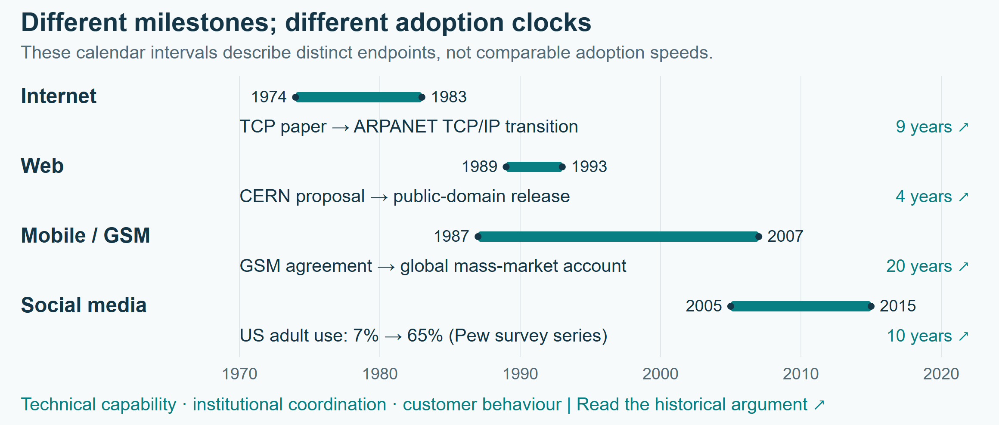

# SYN — A company built to adapt

Business plan and standards roadmap · Alexandru Rada · Editorial edition 1.1 · 13 October 2026

[MVP10 presentation](../../README.md) · [PDF](SYN-BUSINESS-PLAN.pdf) · [Editable Word](SYN-BUSINESS-PLAN.docx) · [Illustrated HTML reader](SYN-BUSINESS-PLAN.html) · [Interactive 3D model](SYN-3D-MAP.html)

The five-section plan is followed by eight annexes, 30 research references, explanatory footnotes and a linked subject index. GitHub renders this text and the figures; open the HTML companions through the local presentation server to use their interactive features.

## Reading guide

- [1 · The SYN proposition](#proposition)

- [2 · Why continuity becomes valuable](#opportunity)

- [3 · From personal work to organisational cooperation](#development)

- [4 · A supported service with cooperative expansion](#economics)

- [5 · An adaptive roadmap](#roadmap)

- [Annex A · Standards, adoption and technological transitions](#standards)

- [Annex B · Research foundations for memory and cooperation](#research)

- [Annex C · Interoperability and governance dependencies](#dependencies)

- [Annex D · Trusted recommendations and delegated negotiation](#trust)

- [Annex E · A visible standard for mediation and arbitration](#arbiter)

- [Annex F · Organisational disclosure, security and cloud delivery](#security)

- [Annex G · Dependency and opportunity register](#register)

- [Annex H · Evaluation programme](#evaluation)

- [References · Business and technological foundations](#references-business)

- [References · Agent systems and governance](#references-agents)

- [Visual atlas](#illustrations)

- [Subject index and notation](#index)

# 1 · The SYN proposition
## A company built to adapt

SYN is being built around a long-term proposition: as AI makes more work possible, people will need dependable ways to select opportunities, carry knowledge forward and cooperate. Company Brain begins with the individual: remembering the context of their work, interpreting their intentions and retrieving methods that have already succeeded. The same continuity can support teams and, when the necessary standards and market conditions exist, a cooperative network of people and businesses.

The commercial proposition is practical: make the next piece of work easier to start, more dependable to finish and more useful to remember. SYN earns revenue from infrastructure subscriptions and the human work of integration, support, consultancy and training. Its accumulated advantage is the relationship between a customer’s context, tested procedures and attributable outcomes. [1](#ref-1), [2](#ref-2)

### The opportunity
As AI expands what individuals can create, coordination becomes a larger part of the work: selecting tools, evaluating alternatives, assembling expertise, agreeing terms and maintaining continuity. SYN’s thesis is that trusted personal agents can reduce this burden while helping people retain direction over their work. The business begins with repeated, observable tasks and grows toward cooperation across organisations.

### The development model
MVP — Personal continuity. A local Company Brain learns the working context of one person through retained preferences, project knowledge, successful methods and corrections.

V1 — Organisational cooperation. Extend personal continuity to a team through permissioned shared knowledge, role-specific agents and governed decision support.

V2 — Cooperative infrastructure. Connect participating people and businesses through an Azure-based service, interoperable agents, delegated negotiation and agreed revenue arrangements.

The stages describe an expanding business purpose, with progress determined by practical dependencies and customer evidence.[^a]

### What SYN builds first
The proposed initial customer is an owner-led creative or technical service business whose recurring work crosses several AI tools. Begin with a small number of repeatable workflows, prove the value of continuity, and charge for a clearly bounded supported service. SYN Studio, SYN Water Engineering and SYN Blockchain are founder-led application domains for developing and demonstrating the wider model; their commercial scale is to be established through their own projects.

The immediate objective is a useful, supported personal service. Each wider stage carries forward what has worked while adapting to new capabilities, standards and forms of cooperation. [Section 3](#development) sets out the release dependencies.

# 2 · Why continuity becomes valuable

### A transition in the work around work
The market opportunity rests on a sequence: more accessible creation produces more possible outputs; more possibilities increase the need for selection and coordination; retained context helps an agent make those choices appropriate to a particular person. SYN proposes to turn that continuity into a dependable service. The magnitude of this opportunity will be measured in customers’ work, including decision time, accepted quality and repeat use.

The ILO’s 2025 task-based index estimates that one in four jobs worldwide has some exposure to generative AI, with transformation the more likely broad outcome than complete replacement. Exposure is a measure of potential task impact.[^b] [3](#ref-3) This favours a business that helps workers reconfigure activities, retain expertise and move between tools.

Anthropic’s January 2026 report, based on November 2025 usage, describes both iterative human–AI work and more automated API use. It reports concentrated use in particular tasks and lower success on more complex work. These vendor observations suggest a market for specialised workflows, contextual support and accountable delegation. [4](#ref-4)

A field experiment across 66 firms and 7,137 knowledge workers found changes in work patterns from access to generative AI. A separate METR experiment with 16 experienced developers and 246 tasks found that the early-2025 tools studied increased completion time by 19%. Together these results make workflow fit and measured customer value central to SYN’s offer. [5](#ref-5), [6](#ref-6)

### From creative abundance to useful selection
SYN treats option fatigue as a customer-discovery hypothesis. Choice-overload research reports substantial variation across settings, including a near-zero average effect in a 2010 meta-analysis. [7](#ref-7) The product should therefore learn when a person wants exploration, a shortlist, a recommendation or direct execution. A user with a clear preference may value a larger choice set; a user facing unfamiliar tools may value a tested starting point.

Example: “Make this like the last successful client proposal” becomes a scoped retrieval task. The agent identifies the project, finds the accepted example and its conditions, checks what has changed, and starts from the relevant method. A new industry or audience changes the procedure’s applicability. The retained value lies in knowing why the earlier work succeeded.

Personal memory reduces repeated setup; shared context supports organisational coordination; trusted histories help agents identify suitable partners; agreed mandates and contracts turn a promising match into a workable collaboration. This sequence connects the personal service to SYN’s cooperative horizon. [Annexes D–E](#trust) develop the market mechanisms.

### Position in the market
Foundation-model platforms supply increasingly capable general tools. Specialist applications supply domain workflows. Consultants supply implementation expertise. SYN combines continuing customer context, cross-tool coordination and supported organisational integration. Its differentiation must be visible in lower repeated setup, fewer correction cycles and dependable handovers. Portable customer records, transparent costs and useful export strengthen the relationship as underlying models change.

# 3 · From personal work to organisational cooperation

### MVP · The personal Company Brain
The local harness maintains the user’s preferences, the agent’s declared role and responsibilities, current projects, relevant sources and reusable procedures. Approximate wording and related concepts help locate the intended task. An interpretation step turns rough input into a workable objective while preserving the user’s meaning.

The agent first looks for a relevant successful workflow: the circumstances, original contribution, corrections, tool configuration and checks that made the result acceptable. When those conditions no longer fit, it researches current methods and records the date and applicability of the replacement. Video research combines available transcripts with relevant frame inspection when visual evidence matters. Useful consequences are retained through the authorised workflow. [1](#ref-1), [2](#ref-2)

The current local development provides the foundation for this stage. Its next commercial milestone is a reproducible supported installation with reliable recovery and measured user value. The business-stage gates below define the transition to wider use.

### V1 · The shared organisational brain
The proposed team stage connects personal agents to a permissioned organisational knowledge system. Workers receive task context; managers coordinate dependencies; auditors inspect evidence; executives consider resource allocation and longer horizons. Each role receives the part of the wider picture necessary for its responsibility. Shared knowledge includes approved documents, meetings and communications, with explicit collection purposes and access rules.

### V2 · The cooperative service
In the proposed cooperative service, Azure would supply elastic infrastructure; SYN would provide integration, operating procedures and continuing support. Participating agents identify complementary skills and opportunities, negotiate within agreed mandates, and present executive decisions to their human principals. Membership grows the range of useful connections. Cooperative governance determines participation, representation, surplus allocation and exit. [8](#ref-8), [9](#ref-9)

| Stage | Dependency that unlocks it | Release evidence |
|---|---|---|
| MVP | Reliable local operation; accurate recall; customers returning to repeated work | Supported installation and recovery; matched workflow evaluation; paid renewal |
| V1 | Enforced identities and roles; permission-aware retrieval; usable shared context | Cross-role disclosure tests; revocation and incident exercises; team pilot |
| V2 | Tenant isolation; delegated authority; interoperable agents; sustainable support | Independent security assessment; negotiation/settlement trials; positive contribution margin |
| Wider ecosystem | Portable trust, dispute rules, local market density and member governance | Repeat cooperative transactions; fair access and appeals; interoperable exit |

Growth is conditional on these gates. A change in model capability, customer behaviour or standards can alter the sequence and implementation while preserving SYN’s purpose.

# 4 · A supported service with cooperative expansion

### Sell a supported outcome
The first offer combines a scoped onboarding project, a recurring infrastructure/support subscription, and separately agreed integration or training hours. Customers pay their attributable cloud and model usage, with pricing and any management margin visible. Visits, process redesign and bespoke workflow engineering are priced as services. Included support has a defined allowance and response level.

Start with founder-domain demonstrations and a small cohort of design partners in one workflow family. Choose work with repeat frequency, an identifiable quality standard and an owner able to approve access. Expand to adjacent teams after repeat value is established. The initial acquisition route is a concrete demonstration followed by a scoped paid pilot; broad ecosystem recruitment follows functioning use cases.

### Economic model
For one customer-month, let S be subscription revenue, U usage billed, H billable service hours, r the hourly price, C the corresponding infrastructure/model cost, h delivery and support hours, w fully loaded hourly delivery cost, and O other variable operating cost.

Π_c = S + U + rH − C − wh − O.  (1)

Illustrative customer-month:[^c] S = £250; U = C = £80; H = 2 at r = £100; h = 3 at w = £40; O = £30. Monthly revenue is £530 and contribution is £300 before fixed overhead. At £6,000 monthly fixed overhead, 20 such customer-months cover that overhead. If delivery rises to six hours, contribution falls to £180 and the equivalent threshold becomes 34 customers. Founder time is included in delivery cost. [Figure 5](#figure5) shows the revenue and cost flows.

The principal operational constraint is support capacity. A subscription works when reusable procedures reduce marginal support while maintaining accepted quality. Track contribution per customer, onboarding payback, support hours, cash collection, renewal and the cost of failures. Usage passed through at cost contributes no margin. Cloud credits, uncontracted demand and unpriced founder labour do not enter the base case.

### An expanding cooperative market
Later membership subscriptions fund shared infrastructure and governance. Project-specific revenue shares are negotiated separately among the parties providing labour, assets, capital and risk. SYN’s service charges remain visible in each agreement. For example, a venue’s agent could assemble performers, event staff and supporting services from opted-in local availability. Agents would compare terms, coordinate bookings and prepare a revenue allocation; people would approve the event and carry out their chosen work. Repeat participation depends on sufficient local membership and reliable fulfilment. [Annexes D](#trust) and [E](#arbiter) follow the agreement and allocation.

SYN’s proposed cooperative model requires explicit member rights, voting, entry, exit, dispute resolution and treatment of surplus. ICA principles provide a starting point for democratic member control and economic participation. [9](#ref-9) The operating rules and legal structure will be developed for the chosen jurisdiction. Personal introductions, dating, entertainment and sport can develop as separately opted-in services as trust and local participation grow. The related thesis [The Architecture of Consent](https://lexspin.github.io/company-brain-papers/architecture-of-consent.html) develops the author’s account of agency and consent. [29](#ref-29)

# 5 · An adaptive roadmap

### Anticipate through observable conditions
SYN uses horizon scanning to maintain several plausible futures and identify what would make each actionable. The internet and mobile eras show that an invention, an interoperable system and a normal market behaviour can emerge years apart. Annex A turns those histories into design lessons without assigning AI a fixed adoption timetable.

| Horizon | Market condition to watch | SYN response |
|---|---|---|
| Personal agent adoption | Customers delegate repeated work and return to retained context | Improve personal continuity and supported workflows |
| Team integration | Organisations permit governed access and can assign accountable owners | Build shared memory and role-specific coordination |
| Agent commerce | Counterparties accept verifiable mandates, machine-readable terms and receipts | Pilot bounded negotiation and revenue allocation |
| Cooperative network | Enough compatible members transact repeatedly within a locality or sector | Offer discovery, matching and shared project formation |

The strategic risk is that general platforms absorb basic memory and workflow features. SYN’s response is to deepen customer integration, evidence portability and domain practice while keeping model and infrastructure dependencies replaceable. A second risk is that demand grows faster than support capacity; the response is a limited service catalogue and measured expansion.

### Illustrative first-cycle programme
First month: define one supported personal deployment, select two recurring workflows, record baseline time and quality, and complete installation/recovery documentation. Interview prospective customers about repeated setup, coordination and willingness to pay. Establish an explicit cloud-cost model and support capacity budget.

Second month: run consented design-partner pilots; measure accepted outcomes, correction effort and total cost. Prototype a role-aware shared-data boundary with synthetic examples. Prepare a draft SYN interoperability profile for review and exchange a test record between two independently implemented agents.

Third month: review paid renewal and delivery economics; decide whether to broaden the personal offer or deepen the existing workflows. Trial negotiation in a sandbox using fixed mandates, synthetic contracts and simulated settlement. Prepare the V1 team pilot only when the access and operational gates are satisfied.

### The horizon-scanning mechanism
Maintain a dated signal register linking each development to a business assumption: model reliability, tool interoperability, delegated authority, identity, regulation, unit costs, customer confidence and local network density. Each signal has a source, expected consequence, review date and decision threshold. Record forecasts with a horizon and probability before the outcome, then assess calibration over time. Near-term customer evidence determines investment; longer-horizon scenarios preserve strategic options.

# Annex A · Standards, adoption and technological transitions

Useful ideas scale through complementary changes: shared interfaces, affordable infrastructure, workable rights and familiar behaviour. The intervals below show how technical availability, institutional coordination and market behaviour develop on different clocks.[^d]

| Era and interval | What became shared | Lesson for SYN |
|---|---|---|
| Internet: 1974 TCP paper to 1983 ARPANET TCP/IP transition — about 9 years [10](#ref-10) | A common way for unlike networks to exchange packets | Agree the interface while allowing independent implementations |
| Web: 1989 proposal to CERN’s 1993 public-domain release — 4 years [11](#ref-11) | Linked information and freely reusable web software | Accessible implementation and low adoption friction help a protocol spread |
| Mobile: 1987 GSM agreement to a worldwide mass market documented in 2007 — 20 years [12](#ref-12) | Operator coordination, compatible networks and services | A specification needs operators, devices, commercial agreements and coverage |
| Social media: US adult use rose from 7% in 2005 to 65% in 2015 — 10 years [13](#ref-13) | Platform participation and social habits on an existing internet | Behaviour spreads through usefulness and social context, alongside technical access |
| Agent systems: current interoperability and payment-mandate initiatives [18](#ref-18), [19](#ref-19), [20](#ref-20) | Common tool access, agent tasks and delegated transaction evidence | Build on these interfaces; define the missing organisational and trust semantics |

The intervals separate three clocks: technical availability, institutional coordination and behavioural adoption. They overlap. [Figure 6](#figure6) plots the source-specific endpoints. A common protocol can reduce integration cost without producing immediate confidence, market density or a sustainable service business.

### Incumbents and transition
Microsoft’s 2015 announcement of approximately $7.6 billion in impairment associated with the Nokia Devices and Services acquisition illustrates how an established company can misjudge the economics of a changing ecosystem. [14](#ref-14) The case concerns a particular business and strategy; it supplies a reason for SYN to monitor changing dependencies and customer habits. The durable lesson is to preserve adaptability before a current distribution model becomes a constraint.

### Stop repeated integration work
For SYN, standardisation means a public versioned interface, precise field meanings, test fixtures, conformance criteria and a change process. Each business should be able to bring its own agent while exchanging the same mandate, offer, work receipt and dispute packet. A reference implementation and two independent interoperating implementations provide an early practical test. Later certification can be assigned to a body with transparent governance.

SYN can sell implementation and support while contributing common exchange formats. Shared standards expand the addressable ecosystem; customer-specific expertise and operating quality supply the commercial distinction.

# Annex B · Research foundations for memory and cooperation

### Memory and procedural continuity
Company Brain’s published thesis draws together retrieval, retained feedback and reusable procedures. Its central mechanism connects the task, applicable sources, method, result and evaluation. A procedure becomes useful when a later task meets its prerequisites and its outcome survives checking (Company Brain §§6.2 and 9; Technical Annexes A and C). [1](#ref-1), [2](#ref-2) SYN’s development opportunity is to package this continuity into a supported personal and organisational service.

### Agents that cooperate and negotiate
Meta’s CICERO combined language and strategic reasoning for Diplomacy. Google DeepMind has also studied communication and cooperation in that game and bartering in multi-agent environments. [15](#ref-15), [16](#ref-16), [17](#ref-17) These research settings provide mechanisms for exchanging proposals, coordinating commitments and responding to other agents. Commercial collaboration adds identity, authority, enforceable terms and settlement to that capability.

### Communication and delegated transactions
MCP provides a common interface between agents and tools; its authorisation specification addresses access to protected resources. A2A describes discovery, messages, tasks and artifacts between independent agents. AP2 describes mandates that connect user-approved authority to transaction verification and receipts. [18](#ref-18), [19](#ref-19), [20](#ref-20) SYN’s proposed profile connects these layers to business-specific meanings: which person is represented, what may be negotiated, what may be committed, and what counts as completion.

### Verifiable evidence and bounded trust
W3C Verifiable Credentials 2.0 supplies an issuer–holder–verifier data model for claims. [21](#ref-21) SYN can use such structures to carry scoped qualifications and work-history attestations. The receiving agent evaluates the issuer, evidence, relevance, freshness and revocation status before using a claim. A personal agent’s endorsement becomes valuable through its ability to connect a recommendation to trusted history and the principal’s needs.

### System-level agent security
Google DeepMind’s June 2026 agent-security framework considers security across model, system and ecosystem layers. Anthropic’s controlled agentic-misalignment research motivates evaluation under conflicting goals and sensitive access. [22](#ref-22), [23](#ref-23) SYN can turn these mechanisms into practical boundaries: narrow mandates, restricted workers, independently checked effects, accountable counterparties and recoverable transactions.

The advanced vision is a market in which an agent can inspect another agent’s capability evidence, propose a cooperation, negotiate a bounded agreement and deliver a verified result. Model progress makes these actions increasingly feasible; shared interfaces make them intelligible to other systems; trusted history makes them relevant to a principal; agreed rules make cooperative activity workable.

# Annex C · Interoperability and governance dependencies

The following are dependency profiles for SYN’s longer-term vision. Existing standards supply possible foundations. The eventual V1 and V2 designs depend on customer requirements, interoperability and legal acceptance; the table identifies what must be resolved without fixing an implementation prematurely.

| Profile | Practical mechanism and foundation | Acceptance condition |
|---|---|---|
| Identity and delegation | Principal, agent identity, issuer, allowed actions, expiry and revocation; credential model plus signed mandate [20](#ref-20), [21](#ref-21) | Wrong principal, expired authority and revoked delegation are rejected |
| Tool and task exchange | MCP tools; A2A tasks, artifacts and capability discovery [18](#ref-18), [19](#ref-19) | Two independent agents exchange a task and reconcile an interrupted response |
| Context and memory | Project scope, source identity/version, purpose, retention and sensitivity; Company Brain records [1](#ref-1), [2](#ref-2) | Stale, cross-project or unauthorised evidence cannot silently become current context |
| Permissioned views | Policy engine filters data before generation; output checks protect the permitted disclosure boundary [8](#ref-8), [24](#ref-24) | Equivalent malicious queries cannot recover another role’s protected facts |
| Work evidence | Signed artifact identity, quality criteria, evaluator, outcome and dispute status | A recommendation can be traced to an actual accepted work receipt |
| Trust and recommendation | Scoped evidence packet; personal-agent fit assessment; issuer/revocation checks [21](#ref-21) | Fabricated histories, circular endorsements and expired claims are detected or withheld |
| Negotiation and contracts | Versioned offer/counteroffer; mandate limits; canonical agreement and approval record [20](#ref-20), [25](#ref-25), [26](#ref-26) | No commitment outside the principal’s mandate; human and machine terms agree |
| Revenue and settlement | Defined revenue basis, deductions, allocation, payment authority and reconciliation | Allocations conserve the agreed total; retries cannot duplicate settlement |
| Arbiter | Published charter, conflict rules, evidence process, evaluation suite and appeal | Symmetric cases receive consistent treatment; contested decisions can be reviewed |
| Interoperable exit | Exportable records, keys/credentials transition, revocation and deletion policy | A member can leave without losing their authorised history or active obligations |

A future exchange profile would need to establish, at minimum, the schema version, message and correlation IDs, issuer, intended recipient, principal, purpose, creation/expiry times, mandate, evidence references and signature method. Business messages carry explicit units, currency, time zone and governing terms. Version changes would require migration guidance and test fixtures.

Conformance progresses from schema validation to adversarial tests, independent interoperability and deployment evidence. A SYN profile would begin as an implementable proposal with a published scope and change process.[^e]

# Annex D · Trusted recommendations and delegated negotiation

### Reviews written for agents
In SYN’s advanced model, a review is primarily an evidence-bearing record that another AI can evaluate. Human prose remains available as an explanation. The machine-readable recommendation packet identifies the work category, requirements, observed result, delivery date, agreed terms, accepted artifact, evaluator, disputes, relationship between reviewer and provider, and permitted uses of the record.

The personal agent compares that packet with its principal’s preferences and constraints. “Suitable for this project” becomes a scoped conclusion supported by relevant experience. An agent can vouch that a provider repeatedly met agreed deadlines on similar work, explain the exceptions, and negotiate terms that account for remaining uncertainty.

### A practical trust mechanism
Let E be the eligible evidence set, c the proposed collaboration and u the principal. Define a decision aid T(u,c | E) using four separately visible dimensions: identity assurance, relevant performance history, compatibility with the principal’s needs and current contractual protection. This is a structured assessment, not a universal social score. Its output includes evidence coverage, uncertainty and the reason for the recommendation.

An endorsement contains scope, issuer, evidence digest, date, expiry and revocation route. The recipient verifies those fields and evaluates the issuer’s credibility. Signed statements protect attribution and integrity; evidence and accountable evaluation establish why the statement should influence a decision. New participants receive an entry route through small bounded trials, qualified references or deposits where appropriate.

### Negotiate through a personal interface
Each principal sets a mandate: acceptable work, budget or price limits, deadlines, protected information, acceptable counterparties, contract templates, approval thresholds and expiry. Agents exchange structured offers and compare alternative allocations. Every counteroffer identifies the exact version it replaces. The system distinguishes exploration, provisional agreement, approval, execution and settlement.

Example: a musician’s agent may negotiate two dates within an agreed fee range while preserving a minimum cancellation payment. The venue’s agent checks capacity, programme fit and budget. A common agreement records performance obligations, equipment, timings, revenue definition, cancellations and dispute handling. The humans can approve the executive decision through their personal interfaces, or authorise bounded commitments in advance where the applicable legal and operating rules permit.

The contract layer maps human-readable terms to a canonical machine representation, records precedence and requires a jurisdiction-specific legal review of the template. UNCITRAL’s 2024 Model Law and the Law Commission’s smart-contract analysis provide useful foundations for automated contracting. [25](#ref-25), [26](#ref-26) Implementation remains tied to the governing law, parties’ authority and the actual agreement.

# Annex E · A visible standard for mediation and arbitration

### A standard everyone can inspect
SYN’s proposed Arbiter Profile defines the institution before choosing its model. Parties agree the charter, scope, decision method, evidence rules, service fees, conflict policy and appeal route. The published configuration identifies the model/version, governing instructions, permitted tools and evaluation version. Private case evidence stays protected; the procedure and material configuration are inspectable.

The arbiter is separate from the agents advocating for each participant. Selection follows agreed qualification and conflict rules. A disclosed random selection among qualified arbiters can reduce discretionary selection where the parties choose it. Funding arrangements are visible, with no reward linked to finding for a particular side.

### A practical case lifecycle
1. Establish the agreement and mandates. Verify the parties, applicable terms, authority and whether the process is advisory mediation or an agreed adjudicative procedure.

2. Assemble a shared case record. Each side receives the relevant allegations, supporting evidence and a defined opportunity to respond. Protect confidential exhibits through agreed disclosure rules.

3. Produce candidate resolutions. The arbiter identifies agreed facts, disputed facts, contract provisions, feasible settlements and unresolved questions. It supplies an attributable explanation and references to the case record.

4. Obtain the required decision. Parties accept a mediated settlement or use the agreed decision route. High-impact and legally consequential matters follow the applicable qualified human process and legal framework.

5. Record and review. Preserve the final decision, authority, appeal status and settlement receipt. Improve the procedure only through a versioned change process with new conformance results.

### Neutrality as an evaluated property
The evaluation suite contains paired cases with the parties’ identities reversed, different writing fluency, missing evidence, conflicting mandates, attempted instructions inside exhibits and incentives to favour the platform. Measure consistency, evidence use, abstention, appeal outcomes and disparate error patterns. Qualified reviewers assess contested cases against the published rubric. The charter specifies the threshold for suspension and the route to reinstatement. [Annex H](#evaluation) connects these checks to the evaluation programme.

### Cooperative revenue example
Illustrative event: £4,000 in collected revenue less £1,000 in agreed direct costs produces £3,000 distributable revenue. The signed allocation assigns 40% (£1,200) to performers, 30% (£900) to venue/operations, 20% (£600) to event staff and 10% (£300) to a cooperative reserve. These are example terms. SYN fees, taxes, refunds, minimum payments and cancellation responsibilities must be expressly included in the agreed basis before settlement.

Agents can negotiate and reconcile this arrangement. Payment authority, safeguarding of funds and dispute resolution follow the chosen licensed providers and jurisdictional requirements. The allocation mechanism can use conventional ledgers; a blockchain becomes useful only where independently verifiable shared settlement supplies a demonstrated benefit.

# Annex F · Organisational disclosure, security and cloud delivery

### An informed organisation with calibrated disclosure
The organisation supplies authorised documents, communications and work context through connectors with explicit ownership and purposes. A policy decision determines which records a role may use before they enter a task. The response layer then adjusts length, terminology, aggregation and format for the recipient. Redaction and permission rules apply to the underlying facts as well as the final prose.

For principal u, task q and record x, define eligibility:

eligible(x,u,q) = identity ∧ permission ∧ purpose ∧ scope ∧ freshness.  (2)

Retrieval ranks only eligible records. A worker sees the relevant assignment; a manager sees authorised dependencies; an auditor sees the evidence required by the audit mandate; an executive sees authorised aggregate information and material exceptions. Escalation expands access only through a valid new mandate. [24](#ref-24)

### Protect the artifacts agents create
Protection covers source files, summaries, embeddings, caches, tool outputs, temporary artifacts, logs, backups and exports. Classify them by tenant, project, sensitivity and retention rule. Use encrypted storage and transport, managed identities, narrowly scoped access, key rotation and revocation. Azure’s multitenant guidance describes isolation choices, including per-tenant vaults and customer-controlled keys. [8](#ref-8)

A key grants cryptographic access to protected material; a policy governs which material may be retrieved and what may be disclosed. Summary length and presentation preferences belong to a separate view policy. Aggregated or randomised statistical releases require explicit privacy parameters and evaluation before they are treated as protective mechanisms.

### A deployable progression
A possible starting arrangement is a controlled single-organisation deployment. Required capabilities include an identity provider, restricted execution, policy-enforced data access, encrypted artifact storage, managed keys, an auditable queue and cost attribution. Tenant templates and recovery procedures would precede pooled resources. The eventual isolation model depends on customer requirements and tested economics.

Compare access-control outcomes against a conventional non-AI service using the same identity and policy rules. Test revocation during a task, role changes, cross-tenant retrieval, compromised tool responses, log access, backup restoration and duplicate effects. The AI can help develop and exercise the tests; an independent security assessment provides a separate release perspective. NIST zero-trust and AI risk guidance provide reference frameworks. [24](#ref-24), [27](#ref-27)

### Human and market dependencies
Team deployment needs transparent collection practices, defined employment purposes, meaningful routes to challenge outputs and jurisdiction-appropriate data protection. [28](#ref-28) Personal work preferences, business performance records and private social interests remain separately governed. Dating, sport or entertainment introductions use their own voluntary purpose and permissions, enabling trust to grow without carrying workplace access into personal life.

# Annex G · Dependency and opportunity register

Each node in the founder’s business model has an implementation path. The register links the proposed value to the dependency that makes it commercially usable.

| Node / opportunity | Mechanism and dependency | Evidence needed for expansion |
|---|---|---|
| Personal identity and preferences | Scoped user profile; declared agent role; editable durable memory | Correct recall, correction, export and deletion behaviour |
| Approximate-language intake | Semantic retrieval plus task interpretation and source selection | Success on paraphrases, ambiguous terms and changed instructions |
| Repeated successful workflows | Versioned examples, prerequisites, corrections and outcomes | Transfer to held-out tasks; lower total correction effort |
| Current workflow discovery | Date-aware primary research; tool checks; knowledge-hub intake | Reproducible workflow on the customer’s actual tools |
| Video knowledge | Timestamped transcripts plus relevant visual evidence | Coverage and source pointers; correct extraction of demonstrated steps |
| Creative abundance and choice | User-controlled explore/shortlist/recommend/execute modes | Faster selection with maintained quality and satisfaction |
| Team memory | Permissioned connectors and shared source definitions | Accurate retrieval across teams with forbidden-access rejection |
| Worker–manager–auditor–executive roles | Bounded mandates and explicit handovers | Traceable responsibilities, escalation and completed outcomes |
| Protected artifacts | Encryption, managed keys, isolation and retention | Key/revocation/recovery tests across derived data and backups |
| Azure subscriptions | Metering, quotas, deployment templates and support capacity | Predictable unit cost, reliable recovery and paid renewal |
| AI-facing reviews | Structured work receipts and verified issuer history | Resistance to false, stale and circular endorsements |
| Personal-agent vouching | Fit assessment against the principal’s needs and trusted evidence | Calibration and useful explanations across new counterparties |
| AI negotiation | Mandates, offer versions, constraints and approval state | No unauthorised commitment; agreement quality and time saved |
| Contracts and revenue shares | Reviewed templates, canonical terms and payment reconciliation | Enforceable operating arrangement and exact allocation accounting |
| Visible arbiter | Public charter, conflict rules, tests and appeals | Symmetry, evidence fidelity and reviewable outcomes |
| Cooperative formation | Membership rules, participant discovery and portable history | Repeat collaboration, fair admission and viable member economics |
| Founder-domain expansion | Studio, water engineering and blockchain application projects | Domain-specific acceptance, qualified oversight and actual demand |
| Local entertainment and gig work | Opted-in availability, bookings, terms and cancellations | Reliable fulfilment, lawful engagement and repeat participation |
| Social introductions | Separate consent, purpose and disclosure settings | Reciprocal interest, withdrawal and trusted human experience |
| Horizon scanning | Dated signals, forecast ledger and investment triggers | Forecast calibration and decisions revised from observed evidence |

# Annex H · Evaluation programme

### Evaluate accumulated usefulness
Compare three conditions on matched recurring tasks: current task context only; current context plus factual memory; and the same facts plus validated procedures. Hold model, tools, task budget and quality rubric constant. Separate development cases from held-out cases, randomise order and include failed attempts in cost. Set sample size from a pilot and the minimum commercially meaningful effect. This extends Company Brain §10 and Technical Annex D. [1](#ref-1), [2](#ref-2)

Primary measures are accepted quality, active human correction time and total cost per accepted result. Secondary measures include time to first useful action, recall precision, stale-source use, rework, customer retention and support hours. A first-pass success rate is accepted first attempts divided by all eligible attempted tasks, with the acceptance rubric fixed in advance.

### Evaluate trust and cooperation
Test human-only coordination, ordinary AI assistance and SYN agents on the same synthetic cooperation cases. Include mutually beneficial negotiations, incompatible mandates, unavailable evidence, strategically misleading counterparties and new entrants with little history. Measure agreement feasibility, mandate violations, allocation accuracy, negotiation time and user satisfaction. Retain disagreements and unsuccessful negotiations as outcomes.

For recommendations, compare predicted suitability with subsequent accepted work. For the arbiter, predefine paired cases and an appeal process. For role-based disclosure, use a known synthetic truth set so that leaked facts and incorrect denials are countable. An evaluation failure narrows the deployment scope and supplies a concrete repair target.

### Notation and economic controls
Q is the number of accepted results; C_total includes model/tool usage, human time and failed attempts. Cost per accepted result is C_total / Q when Q is positive; report “undefined” when no result is accepted. For distributable revenue D and agreed nonnegative shares a_i, settlement is payment_i = a_i D, with the shares summing to one. Contracts specify how losses, minimum fees and reserves alter that rule.

For forecast k, record probability p_k and eventual binary outcome y_k. The mean Brier score is the average of (p_k − y_k)². Use it with coverage and decision usefulness; selective forecasting of easy questions should not count as broad predictive competence.

### Development outputs
The next investment packet comprises a supported MVP specification, a measured pilot report, a SYN interoperability profile, a synthetic negotiation/arbiter test suite, a jurisdiction-specific contract template and an Azure cost/isolation design. These are separable deliverables. Their results determine the next business iteration.

### Related research and navigation
The [Company Brain thesis](https://lexspin.github.io/company-brain-papers/company-brain.html) develops the architecture; its [technical annexes](https://lexspin.github.io/company-brain-papers/technical-annexes.html) set out record contracts and evaluation boundaries. [1](#ref-1), [2](#ref-2) The separate [Architecture of Consent thesis](https://lexspin.github.io/company-brain-papers/architecture-of-consent.html), §9, and its [Analytical Annex D](https://lexspin.github.io/company-brain-papers/consent-annex.html) discuss the evaluation of lasting behavioural effects. [29](#ref-29), [30](#ref-30) The [subject index](#index) links concepts, notation and substantive discussions.

# References · Business and technological foundations

**[1]** Rada, A. (11 October 2026). Company Brain: From Human Learning to Accountable Agent Orchestration. Research manuscript, edition 1.1. [Read the paper](https://lexspin.github.io/company-brain-papers/company-brain.html). Architectural argument and scoped educational demonstration.

**[2]** Rada, A. (11 October 2026). Company Brain: Technical Annexes, A–F. [Technical annexes](https://lexspin.github.io/company-brain-papers/technical-annexes.pdf). Record contracts, evaluation design and reproduction boundaries. Public collection: [reading room](https://lexspin.github.io/company-brain-papers/).

**[3]** Gmyrek, P., Berg, J., Kamiński, K., Konopczyński, F., Ładna, A., Nafradi, B., Rosłaniec, K. & Troszyński, M. (2025). [Generative AI and Jobs: A Refined Global Index of Occupational Exposure](https://www.ilo.org/publications/generative-ai-and-jobs-refined-global-index-occupational-exposure). ILO Working Paper 140. DOI: 10.54394/HETP0387.

**[4]** Anthropic (15 January 2026). Anthropic Economic Index report: Economic primitives. [Report](https://www.anthropic.com/research/anthropic-economic-index-january-2026-report). Vendor analysis of November 2025 usage; platform-specific observational evidence.

**[5]** Dillon, E. W., Jaffe, S., Immorlica, N. & Stanton, C. T. (2025). Shifting Work Patterns with Generative AI. [Author preprint](https://arxiv.org/abs/2504.11436v4). Field experiment across 66 firms and 7,137 knowledge workers.

**[6]** Becker, J., Rush, N., Barnes, E. & Rein, D. (2025). Measuring the Impact of Early-2025 AI on Experienced Open-Source Developer Productivity. [Author preprint](https://arxiv.org/abs/2507.09089v2). Randomised study; 16 developers, 246 tasks, tools available February–June 2025.

**[7]** Scheibehenne, B., Greifeneder, R. & Todd, P. M. (2010). Can There Ever Be Too Many Options? A Meta-Analytic Review of Choice Overload. Journal of Consumer Research 37, 409–425. [Author-hosted paper](https://scheibehenne.de/ScheibehenneGreifenederTodd2010.pdf). DOI: 10.1086/651235.

**[8]** Microsoft. Azure Architecture Center: [multitenant architecture](https://learn.microsoft.com/en-us/azure/architecture/guide/multitenant/overview) and [Key Vault isolation](https://learn.microsoft.com/en-us/azure/architecture/guide/multitenant/service/key-vault). Technical design guidance; deployment must be tested.

**[9]** International Cooperative Alliance. [Cooperative identity, values and principles](https://www.ica.coop/en/cooperatives/cooperative-identity/). Governance foundation, distinct from a jurisdiction-specific incorporation decision.

**[10]** Leiner et al., Internet Society. [A Brief History of the Internet](https://www.internetsociety.org/internet/history-internet/brief-history-internet/). Historical account by internet pioneers.

**[11]** CERN. [The birth of the Web](https://home.cern/science/computing/the-birth-of-the-web/). 1989 invention and 30 April 1993 public-domain release.

**[12]** GSMA (2007). [Global Mobile Communication is 20 years old](https://www.gsma.com/newsroom/press-release/global-mobile-communication-is-20-years-old/). Institutional account of the 1987 agreement and subsequent reach.

**[13]** Perrin, A., Pew Research Center (2015). [Social Media Usage: 2005–2015](https://www.pewresearch.org/internet/2015/10/08/social-networking-usage-2005-2015/). US adult survey series; figures use the report’s stated population.

**[14]** Microsoft (8 July 2015). [Restructuring of phone hardware business](https://news.microsoft.com/source/2015/07/08/microsoft-announces-restructuring-of-phone-hardware-business/). Primary corporate announcement of impairment and strategic change.

# References · Agent systems and governance

**[15]** Meta (2022). [CICERO: collaboration and negotiation](https://about.fb.com/news/2022/11/cicero-ai-that-can-collaborate-and-negotiate-with-you/). Research demonstration in Diplomacy.

**[16]** Bachrach, Y. & Kramár, J. (6 December 2022). [AI for the board game Diplomacy](https://deepmind.google/blog/ai-for-the-board-game-diplomacy/). Google DeepMind research report.

**[17]** Johanson, M., Hughes, E., Timbers, F. & Leibo, J. (16 May 2022). [Emergent bartering behaviour in multi-agent reinforcement learning](https://deepmind.google/blog/emergent-bartering-behaviour-in-multi-agent-reinforcement-learning/). Google DeepMind research report.

**[18]** Model Context Protocol. [2025-06-18 authorisation specification](https://github.com/modelcontextprotocol/modelcontextprotocol/blob/main/docs/specification/2025-06-18/basic/authorization.mdx); [November 2025 specification release](https://blog.modelcontextprotocol.io/posts/2025-11-25-first-mcp-anniversary/). Pin a supported version for implementation and conformance.

**[19]** Agent2Agent project. [A2A specification v1.0.0](https://a2a-protocol.org/v1.0.0/specification/). Discovery, messaging, tasks and artifacts between agent systems.

**[20]** Agent Payments Protocol. [Agent Authorization Framework](https://ap2-protocol.org/ap2/agent_authorization/). Mandate delegation, verification and receipts; payment-oriented specification.

**[21]** W3C (15 May 2025). [Verifiable Credentials Data Model v2.0](https://www.w3.org/TR/vc-data-model-2.0/). Recommendation; issuer, holder and verifier relationships.

**[22]** Google DeepMind (June 2026). [The Three Layers of Agent Security](https://storage.googleapis.com/deepmind-media/DeepMind.com/Blog/securing-the-future-of-ai-agents/three-layers-of-agent-security.pdf). Research framework spanning model, system and ecosystem security.

**[23]** Anthropic. [Agentic Misalignment in Summer 2026](https://alignment.anthropic.com/2026/agentic-misalignment-summer-2026/). Controlled evaluation research; deployment-specific assessment remains necessary.

**[24]** NIST (2020). [SP 800-207: Zero Trust Architecture](https://csrc.nist.gov/pubs/sp/800/207/final). Resource-focused access-control architecture.

**[25]** UNCITRAL (2024). [Model Law on Automated Contracting](https://uncitral.un.org/en/mlac). Legislative model for automated transactions; local adoption and applicable law require separate assessment.

**[26]** Law Commission of England and Wales (2021). [Smart contracts](https://lawcom.gov.uk/project/smart-contracts/). Advice on support for smart legal contracts within that jurisdiction.

**[27]** NIST (2024). [AI 600-1: Generative Artificial Intelligence Profile](https://nvlpubs.nist.gov/nistpubs/ai/NIST.AI.600-1.pdf). Risk-management guidance.

**[28]** Information Commissioner’s Office. [Employment practices and data protection: monitoring workers](https://ico.org.uk/for-organisations/uk-gdpr-guidance-and-resources/employment/monitoring-workers/). Guidance for assessing workplace data use; consult current jurisdiction-specific requirements at deployment.

**[29]** Rada, A. (11 October 2026). [The Architecture of Consent](https://lexspin.github.io/company-brain-papers/architecture-of-consent.html). AI-mediated learning, collective practice and authority over the conditions of choice. Research manuscript, edition 1.1.

**[30]** Rada, A. (11 October 2026). [The Architecture of Consent: Analytical Annex](https://lexspin.github.io/company-brain-papers/consent-annex.html). Edition 1.1; propositions, analytical models and proposed evaluation.

Research and access date: 13 October 2026. The plan combines the founder’s business direction, existing Company Brain publications and selected primary research, institutional sources and protocol documentation. Proposed SYN profiles, example prices, allocations and pilot milestones describe the development plan. This edition was prepared with AI-assisted research, drafting and document production.

## Visual atlas

Figure 1. SYN’s conditional development path. Personal continuity is the starting point; wider coordination depends on access, trust, interoperability and customer evidence. Arrows indicate dependencies rather than release dates.

Figure 2. From delegated mandate to settled collaboration. Each transition requires the authority and evidence appropriate to the agreement; Annexes D–E follow the negotiation and allocation.

Figure 3. Linked 3D map of the SYN business model. Nodes connect opportunities, enabling dependencies and source material. Spatial position is conceptual: it does not measure maturity, value or probability.

[Explore the interactive 3D map](SYN-3D-MAP.html).

![Company Brain MAPS interface, reproduced from the paper collection published on 11 October 2026. It shows the development interface’s relationships among projects, knowledge, roles and workflows. Source: Company Brain Technical Annexes [2].](figures/company-brain-published-snapshot.png)

Figure 4. Company Brain MAPS interface, reproduced from the paper collection published on 11 October 2026. It shows the development interface’s relationships among projects, knowledge, roles and workflows. Source: Company Brain Technical Annexes [2].

Figure 5. Illustrative customer-month economics. The support-sensitive contribution is £300 at three delivery hours and £180 at six hours. Values follow equation (1); they are planning assumptions.

Figure 6. Different clocks in technological transitions. The marked intervals use the source-specific endpoints in Annex A. They represent different historical processes rather than comparable adoption speeds.

## Subject index and notation

| Topic | Read |
|---|---|
| Agent identity | [3 · From personal work to organisational cooperation](#development), [Annex C · Interoperability and governance dependencies](#dependencies) |
| AI-facing reviews | [Annex D · Trusted recommendations and delegated negotiation](#trust), [Annex G · Dependency and opportunity register](#register) |
| Arbiter | [Annex E · A visible standard for mediation and arbitration](#arbiter), [Annex H · Evaluation programme](#evaluation) |
| Azure | [3 · From personal work to organisational cooperation](#development), [Annex F · Organisational disclosure, security and cloud delivery](#security) |
| Choice and selection | [2 · Why continuity becomes valuable](#opportunity), [Annex D · Trusted recommendations and delegated negotiation](#trust) |
| Consent and agency | [4 · A supported service with cooperative expansion](#economics), [Annex F · Organisational disclosure, security and cloud delivery](#security) |
| Contracts | [Annex D · Trusted recommendations and delegated negotiation](#trust), [Annex E · A visible standard for mediation and arbitration](#arbiter) |
| Cooperative governance | [4 · A supported service with cooperative expansion](#economics), [Annex E · A visible standard for mediation and arbitration](#arbiter) |
| Delegated authority | [Annex C · Interoperability and governance dependencies](#dependencies), [Annex D · Trusted recommendations and delegated negotiation](#trust) |
| Disclosure and encryption | [Annex F · Organisational disclosure, security and cloud delivery](#security) |
| Founder domains | [1 · The SYN proposition](#proposition), [Annex G · Dependency and opportunity register](#register) |
| Horizon scanning | [5 · An adaptive roadmap](#roadmap), [Annex H · Evaluation programme](#evaluation) |
| Interoperability | [Annex A · Standards, adoption and technological transitions](#standards), [Annex C · Interoperability and governance dependencies](#dependencies) |
| Local entertainment and gig work | [4 · A supported service with cooperative expansion](#economics), [Annex E · A visible standard for mediation and arbitration](#arbiter) |
| Memory | [3 · From personal work to organisational cooperation](#development), [Annex B · Research foundations for memory and cooperation](#research) |
| Negotiation | [Annex D · Trusted recommendations and delegated negotiation](#trust), [Annex E · A visible standard for mediation and arbitration](#arbiter) |
| Personal-agent vouching | [Annex D · Trusted recommendations and delegated negotiation](#trust) |
| Revenue allocation | [4 · A supported service with cooperative expansion](#economics), [Annex E · A visible standard for mediation and arbitration](#arbiter) |
| Standards and adoption | [Annex A · Standards, adoption and technological transitions](#standards), [Annex C · Interoperability and governance dependencies](#dependencies) |
| Support economics | [4 · A supported service with cooperative expansion](#economics) |
| Trust and work history | [Annex D · Trusted recommendations and delegated negotiation](#trust) |
| Workflow reuse | [3 · From personal work to organisational cooperation](#development), [Annex H · Evaluation programme](#evaluation) |

### Notation

| Symbol | Meaning |
|---|---|
| Π_c; S; U | Customer-month contribution; subscription revenue; usage billed. |
| H; r; C; h; w; O | Billable hours; price/hour; infrastructure cost; delivery hours; delivery cost/hour; other variable cost. |
| u; c; E; T(u,c \| E) | Principal; proposed collaboration; eligible evidence set; scoped trust assessment. |
| eligible(x,u,q) | Boolean eligibility of record x for principal u and task q. |
| Q; C_total | Accepted results; total task cost including failures and human effort. |
| D; a_i; payment_i | Distributable revenue; agreed share; payment_i = a_i D. |
| p_k; y_k | Forecast probability and observed binary outcome for case k. |

### Explanatory footnotes

[^a]: MVP, V1 and V2 denote commercial development stages in this plan. Current software iteration labels belong to the project’s development history.

[^b]: The ILO index estimates task exposure. Product demand, adoption and realised productivity require separate customer evidence.

[^c]: All amounts are illustrative GBP values for one customer-month, before fixed overhead. They are planning assumptions rather than a tariff or revenue forecast.

[^d]: Each interval uses the endpoints identified in its source. The periods are not comparable estimates of time to adoption, and do not prescribe an AI-market timetable.

[^e]: An implementation profile selects and connects existing specifications for a particular use. Formal standardisation requires the relevant standards process and wider agreement.
