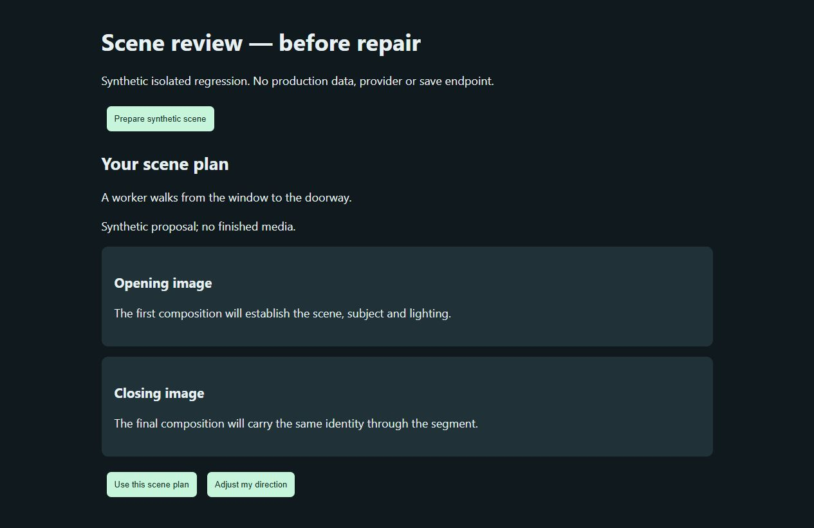
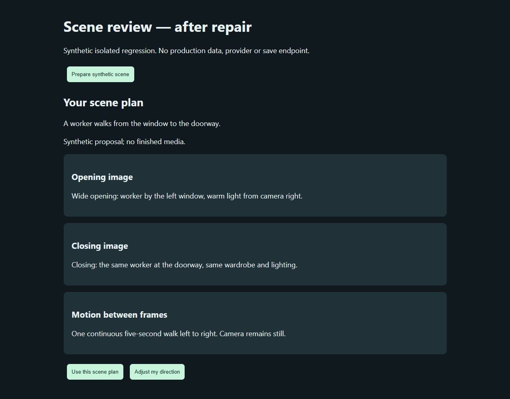

# Company Brain commercial readiness adversarial audit

Technical annex · 13 October 2026 · Draft for executive review and owner acceptance

## Present verdict and scope

Company Brain is not ready for commercial release on the evidence available to this audit. The local prototype contains useful, inspectable mechanisms and attributable results, and six reproduced defects received scoped source repairs. Material release obligations remain: the running backend uses older imported code, navigation publication is degraded, arbitrary host callbacks are not sandboxed, and full provider and scheduled cycles have not been verified. A release decision also needs a defined deployment profile, such as a trusted single-owner tool or an authenticated shared service.

This verdict applies to the current installation and its readiness evidence. It preserves the base framework's research thesis: retained, current evidence and tested procedures may improve later accepted work, and that proposition needs controlled evaluation. The framework distinguishes its deterministic teaching companion from a proposed shared application. Missing shared-service capabilities therefore do not refute what the companion demonstrated. They do prevent treating that demonstration as commercial assurance.

The audit examined material security, stack, agent, harness, memory, interface and maintenance claims in a bounded source corpus. It compared those propositions with current contracts, source observations, the latest self-repair annex, an interface dissection and an individual registry review. The framework coverage includes selected installation, task/context, permissions, recovery, evaluation and validity sections; all 59 pages and visual diagrams were not comprehensively audited. Source DOCX access remains a gap. Claims outside the inspected corpus remain outside coverage; this is neither an exhaustive penetration test nor a claim that every historical statement was checked.

## Evidence must follow the actual boundary

The strongest recurring risk is substituting evidence from one boundary for evidence at another. A registered worker describes intended responsibility. A passing fixture establishes exercised mechanics. A release file can differ from the canonical source. A successful archive receipt does not establish clean navigation publication. A connection probe does not establish a provider's full work and recovery path.

The earlier same-day browser review verified real output links and repaired presentation. Its observations remain useful dated evidence. The new interface reviewer initially could inspect source and published state but could not create a fresh browser tab. Browser access subsequently returned to the audit coordinator, who inspected 12 workspace views, MAPS and six Creative views. The scene approval comparison was rendered in an isolated synthetic fixture without production data, provider calls or save endpoints. These are fresh observations with their own scope; reusing an earlier screenshot cannot certify a later change merely because the screen looks similar.

The source/runtime split is already consequential. The prior Results repair initially passed source checks while the gateway continued serving a release script. Synchronizing the relevant file then changed the actual view. This audit integrated the changed release files within a scoped synchronization that preserved preexisting divergence. Served Creative script hashes now match their checked source. Results is injected into the workspace HTML, where its checked source and refresh signature were confirmed; its absent standalone route is expected. The backend still retains older imported code and pagination behavior because restart remains blocked. A clean source tree or a large passing suite cannot establish that a running process loaded those changes.

## Mechanisms that have support

The inspected implementation specifies one canonical writer, durable file history, a SQLite query projection, versioned records, expected-version mutation and an explicit request/claim/result lifecycle. Ledger hashes detect alteration under the stated recovery model; the documentation correctly disclaims protection against an account owner deliberately rewriting an entire history. Recovery and sharing also require the separately owned queue, routine and artifact files. They cannot be inferred from a database copy alone.

The routed harness applies current project, role and skill bindings to participating callers and checks declared requirements, exact artifact destinations and retained-result evidence. A previous self-repair run completed against its original archive receipt after a line-ending comparison defect was fixed without relaxing artifact byte hashes. The result was retrieved by exact identity, found through bounded search and checked for reciprocal links. That is an observed scoped completion, not proof that every host tool or conversation is intercepted.

Memory recall is bounded selection and truncation with source pointers. It does not guarantee meaning-preserving compression. Candidate procedures remain separate from accepted records, and promotion requires tests appropriate to their scope. The base paper's matched evaluation distinguishes essential task context, factual memory and validated procedures. That design remains the appropriate route to a productivity claim; counts of retained records or configured roles cannot supply the missing comparison.

## Adverse findings and current repair boundary

The registry review individually inventoried all 93 active records: 25 agents, 52 skills and 16 loops. It also checked nine local steps, two deterministic routines, 25 role profiles and 105 existing direct or linked local source paths. These totals describe coverage. They do not establish that each role ran or that every domain procedure is semantically correct. Two declared source hashes differed from current installed instructions, and 17 of 25 role profiles contained stale linked-skill versions. Each discrepancy needs semantic reconciliation; additive archive backlinks and changed procedure instructions have different consequences.

Instruction quality also depends on what is actually consumed. Stored role and skill text can be injected into a workflow while linked local source documents remain unread. A graph edge therefore cannot establish source coverage. At the registry snapshot, local draft steps kept the last 40,000 characters of concatenated earlier outputs without an omission marker, allowing a source identity or early qualification to disappear; the subsequent source repair is described below. The chat evidence surface marks its own truncation separately. Mechanical validation checks artifact integrity, freshness and citation identity; a model review that enumerates at most 40 claims and verifies quote membership does not prove exhaustive factual coverage or entailment. Legacy instructions, inline loop summaries and current exact skills also require explicit precedence and loading.

The audit coordinator reproduced and repaired stage-context drift, native Results refresh, Creative partial-success notices, hidden scene proposals, context omission and malformed HTTP inputs. The final backend suite passed 578 tests in 228.113 seconds. Six Node scripts passed, and the release checkout passed 28 focused checks: 21 routing, three HTTP and four context checks. An initial module-style release invocation failed on its import path; corrected discovery passed. The original failed reproductions remain retained. Independent source and log review confirmed resolution of the two residual findings described below. Backend source repairs remain checked changes awaiting activation in the old running process. An accepted deployment must additionally show that the service the owner uses matches the tested source.

Stage-context drift threatened the promise that binding instructions remain current before meaningful work. Four retained reproductions failed at that boundary before repair; the repaired source passed the expanded stage checks. It revalidates the currently published bound context before participating callbacks. Independent review identified an additional mutable-plan gap; the audit coordinator then added a checked comparison of the in-memory plan with its immutable disk contract. A published snapshot can still be up to 30 seconds old, and no transaction lock makes the observation atomic with all later effects. Fixing a callback gate in source does not change an older running service. The audit must report those facts separately.

The interface dissection identified three concrete failures. Results refresh observed ordinary runs but could miss native-object transitions while its header updated. Creative board save could report that links were saved despite a backend link warning. Scene-plan approval could apply opening, closing and motion details that the dialog did not show. The repaired source includes native state and freshness in its refresh signature, surfaces both link and publication warnings, and displays the actual escaped scene details before approval. Isolated UI scenarios passed. The fresh synthetic scene comparison illustrates the third repair; no provider or production save was needed to demonstrate it.

HTTP hardening rejects duplicate keys, literal nonfinite constants and unsupported framing at the exercised source boundary. Independent review reproduced a residual gap: an exponent such as 1e999 parsed as infinity without entering the literal-constant rejection. The audit coordinator then repaired positive and negative overflow representations with passing focused tests. Live activation remains separate. Loopback binding, origin/token checks, bounded bodies and validated IDs are useful controls. They do not establish authenticated multiuser isolation or a host filesystem sandbox. Those stronger properties require their own executable boundary and evidence. The pure parser reproduction did not contact a live endpoint or establish exploit success; no complete security assurance is claimed here.

The context repair rejects preceding-output text over 40,000 characters before the model call instead of silently discarding its beginning. It preserves the source boundary by failing closed. That character limit applies to earlier outputs, not the whole assembled prompt or model tokens; it also does not prove resistance to malicious instructions within visible source text. A register maps 26 command endpoints to their common boundary and individual limits. Shared parsing and queue checks do not establish every downstream provider's authority, outcome or recovery behavior.

## Direction that preserves the framework

The owner's selected direction preserves substantial reasoning, existing pulses and passive capture of useful interactions, methods and examples. It introduces a clearer authority boundary: a trusted coordinator owns scope and current context, restricted application workers return candidate outputs, and validated canonical commands own durable writes. Deep reasoning can continue within that structure; reducing a worker's effectful privileges does not require reducing its analytical contribution.

This is an architectural direction for the next bounded implementation, not evidence that every current host worker is contained. The coordinator should assemble source identity, exact applicable instructions, permitted tools and acceptance into each work packet; the worker returns attributable observations and candidate artifacts; the canonical writer checks current authority, versions and effect identity before mutation. Important interaction capture should preserve the original source and distinguish an accepted capture from verified factual claims or promoted procedures. Existing pulse admission, ownership and stop conditions remain obligations. Native host tools outside interception remain an explicit limit until an executable host boundary exists.

## Commercial release gates

Release should be contingent on a named deployment profile and observable gates. A trusted single-owner local tool and a shared commercial service have different threat models, but both need a current served build, reliable status, checked artifacts, recovery and truthful limitations. The current installation should remain a bounded local development system while those obligations are open.

| Gate | Required acceptance evidence | Present status |
|---|---|---|
| Deployment parity | Serving build identity, permitted activation and clean publication readback | Not met: older service code and degraded navigation publication |
| Human acceptance | Fresh ordinary/adverse browser flows for changed screens | Workspace/Creative read inspection and isolated scene rendering observed; full effectful flows unverified |
| Binding integrity | Before-stage drift tests, normal work and unchanged acceptance criteria | Source checks and final suite passed; old backend activation pending |
| Input boundary | Invalid JSON/framing rejection and valid request compatibility | Source checks include overflow correction; old backend activation pending |
| Instruction quality | Individual registered review, source/hash reconciliation, current bindings and attributable source consumption | Inventory complete; semantic/live compliance and identified reconciliation gaps remain |
| Provider and recovery | Real authorized output, interruption/effect reconciliation and complete cost accounting | Unverified |
| Scheduled operation | Eligible occurrence with one owner, checked outcome and retained receipt | Unverified |
| Shared-service security | Authenticated identity, project access, protected transport/artifacts and adversarial checks | Proposed expansion; absent from present assurance |
| Dependency provenance | Complete bundled transitive dependency and licence inventory | Partial named-component evidence; complete inventory remains open |
| Utility | Representative matched comparisons of accepted quality, correction time and total cost | Proposed evaluation; no measured gain |

The executive decision should name which profile is being prepared, assign each unmet gate and retain evidence for failures as well as passes. A marketing statement should inherit the narrowest demonstrated boundary: source-inventoried methods remain an inventory; caller-reported activity remains reported; a checked local run remains one run. Commercial readiness follows when the intended deployment's material obligations are met.

## Evidence coverage

This annex uses the Company Brain Framework, Draft 1.1, selected installation and execution sections and its evaluation/validity sections; current architecture, file-store, routed-execution, harness and V9 memory/validation documentation; and the 13 October self-repair, interface and individual registry observations. Historical results are kept separate from new checks. The claim register gives each material proposition a supported, contradicted, unverified or aspirational classification, with the exact internal locator and the boundary at which it applies. Stronger commercial interpretations are identified as interpretations rather than silently attributed to the framework.

The registry review also consulted selected NIST generative-AI risk guidance, the inspected 2025 OWASP prompt-injection and excessive-agency guidance, and Anthropic's context-engineering discussion. These inform adversarial cases and the distinction between instructions and executable authority; they do not establish standards compliance or local efficacy. Coverage was selective and no source code was reused. [NIST AI 600-1](https://nvlpubs.nist.gov/nistpubs/ai/NIST.AI.600-1.pdf), [OWASP prompt injection](https://genai.owasp.org/llmrisk/llm01-prompt-injection/), [OWASP excessive agency](https://genai.owasp.org/llmrisk/llm062025-excessive-agency/), [context engineering](https://www.anthropic.com/engineering/effective-context-engineering-for-ai-agents).

## Observed interface evidence

Figure 1. Isolated synthetic proposal before repair. The opening and closing panels contain generic descriptions, and no motion panel exposes the actual proposal. “Use this scene plan” would apply details that this view does not show. This is a rendered regression fixture, not a provider response or production save. Screenshot unchanged; no private project data was used.

Figure 2. The same synthetic proposal after repair. Opening location/light, closing composition and the five-second movement are now visible before approval. The person can inspect what would be applied and choose “Adjust my direction.” This verifies proposal presentation in the isolated fixture; it does not establish image identity, generation quality or successful media delivery. Screenshot unchanged.
