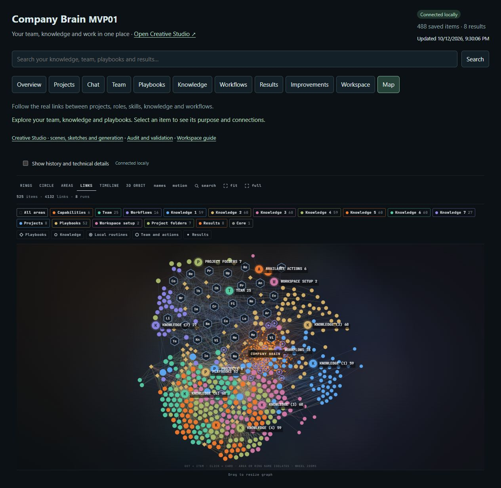
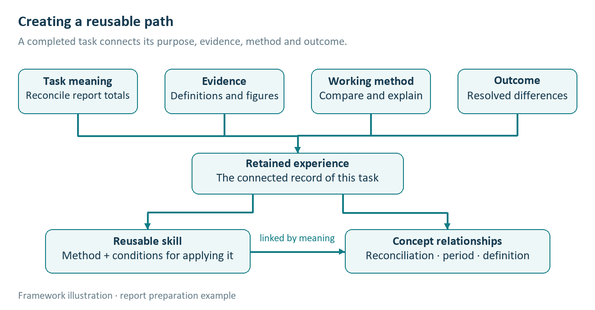
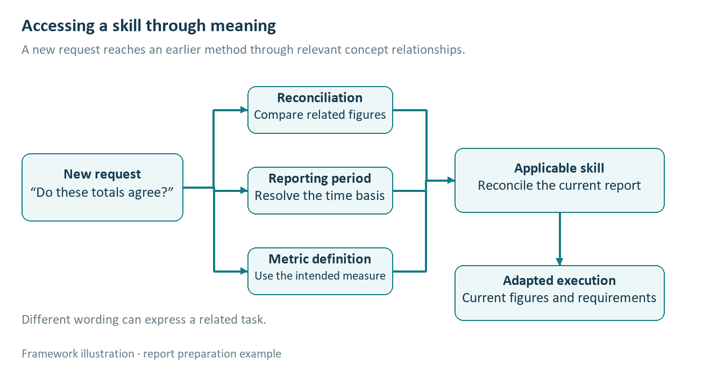
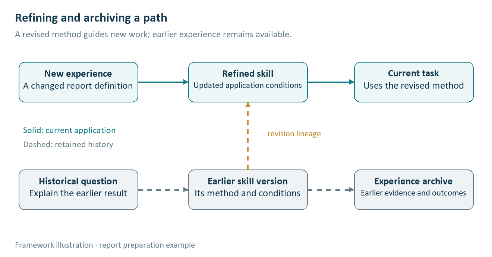

# Appendix F. Semantic continuity and procedural learning

Research continuation · 12 October 2026

## F.1 Experience becomes available through meaning

Company Brain begins with the proposition that accepted work can become knowledge and procedures for subsequent work. The continuing development of this framework brings a particular behaviour into focus: a later request can recover a relevant method through the concepts it shares with earlier experience. The person describes what they want to accomplish, and the relationship between that intention, the subject and a learned procedure makes the earlier work useful again.

In my use of Company Brain, I have observed related language in later requests bringing relevant skills back into the work. Corrections can also carry forward, influencing how a familiar kind of task is approached. These qualitative observations extend the informal motivation described in Section 1. They direct attention to the connections through which an experience becomes available again: the meaning of the request, the conditions of the earlier work and the method that proved useful.

The framework treats this as semantic continuity. A request concerning the explanation of a technical argument can relate to earlier experience in preserving causal order, choosing supporting evidence and adapting terminology to an audience. The wording may change while these relationships remain meaningful. Repeated experience can enrich the association between a kind of intention and an appropriate way of fulfilling it when useful distinctions are retained.

This gives the accumulated knowledge a practical structure. An accepted result contributes an example; its correction contributes a distinction; a reusable skill expresses the method that those experiences support. Later work can draw upon all three. Their connection allows the system to move from recognising a familiar topic to selecting a useful procedure and adapting it to the current purpose.

## F.2 From recognition to a learned procedure

A useful skill preserves the relationship between a problem and a method. In preparing an explanation, for example, the relevant experience may be that readers understood a mechanism more readily when its cause appeared before its consequence. The reusable knowledge is the relationship between explanation order and comprehension. A later request about another mechanism can call upon that method while supplying its own subject matter and evidence.

Agent Workflow Memory investigates a related computational mechanism: deriving reusable workflows from experience and selectively providing them during later tasks. Its web-navigation setting gives a research example of how an earlier sequence of actions can guide new work. [F1](https://arxiv.org/abs/2409.07429v1) ExpeL similarly examines the extraction of natural-language insights from experience and the retrieval of those insights alongside relevant examples. [F2](https://arxiv.org/abs/2308.10144v3) Both help explain why the representation of an experience matters to its subsequent usefulness.

Company Brain develops this relationship at the level of continuing organisational work. A method remains connected to its purpose, the circumstances in which it helped and the corrections that refined it. As related requests recur, these connections support recognition and adaptation. Procedural knowledge develops through the preservation of meaningful distinctions across successive tasks.

## F.3 Correction gives experience greater precision

A correction often reveals what an initial request left implicit. A person may accept the facts in an explanation while asking for its argument to follow a different order. That intervention identifies a relationship between purpose, audience and presentation. Preserving the relationship makes the correction useful when a later task raises the same issue.

Reflexion studies how linguistic feedback retained from an attempt can influence subsequent attempts. [F3](https://arxiv.org/abs/2303.11366v4) Agentic Context Engineering examines evolving contextual playbooks, with generation, reflection and curation contributing structured changes over time. [F4](https://arxiv.org/abs/2510.04618v3) These approaches illuminate the computational role of retained feedback: an experience changes the material available for future reasoning.

Within Company Brain, a correction becomes more useful when its scope remains intelligible. A preference for accessible language in an introductory explanation belongs with that audience and purpose. A specialist treatment can draw upon the same underlying knowledge while developing greater technical depth. The retained lesson supports this choice by preserving why the earlier correction mattered.

# Appendix G. The framework in practice

## G.1 Connect intention, knowledge and method

The framework connects five elements of continuing work: the person's intention, the concepts expressed by the task, relevant knowledge, an applicable method and the consequence of using it. Each task supplies a new combination. As useful distinctions accumulate, these relationships can make familiar methods accessible through a wider range of meaningful requests.

MAPS and ARMS, introduced in Appendices D and E, provide complementary views of this organisation. MAPS relates memory, agent execution, recurring work and the screen through which the work is encountered. ARMS foregrounds applications, routines, memory and skills. Together they help describe how retained knowledge becomes accessible, how methods become reusable and how an interface supports the person's continuing relationship with the work.

The task determines which part of this knowledge is useful now. A request to explain a decision may need the decision's purpose, supporting evidence and an explanatory method. A request to reconsider it may need the same background together with new evidence and a method for comparing alternatives. The subject provides continuity while the intention changes the procedure.

### G.1.1 Reading the map as an observation surface

A node represents an item relevant to the work: a request, source, skill, application or result. A link records a particular relationship between two items. Access connects a task to the source it consulted; use connects it to the method it applied; creation connects the producing tool to its output. Saving a result preserves these relationships, while revision connects an updated method to its predecessor.

The application’s Links layout provides a spatial view of connected records. The opening control-room concept develops this visual language into an observation surface: an active neighbourhood comes into focus, a request appears briefly, and highlighted connections identify the selected action. Images and applications appear beside the activity that produces them. A timeline allows the observer to revisit a step and follow its consequence.

Available context, current activity and lasting change have different meanings in this view. A recorded relationship establishes how two items are connected; an observed access identifies a use of that relationship at a particular time. Keeping these meanings visible helps the reader distinguish what is available, what is happening and what has been retained.

## G.2 An explanation that carries a correction forward

Consider an illustrative request to explain how a heat pump works to a general reader. The relevant concepts include energy transfer, temperature difference and the purpose of the explanation. A learned explanatory method can organise these ideas around a familiar observation, introduce the physical mechanism and then connect that mechanism to its practical consequence.

Suppose the person asks for a revision because the first explanation names components before establishing what they do. The correction clarifies the desired relation between function and terminology. A subsequent request to explain refrigeration can recover this method through the shared concepts of heat transfer and causal explanation. The new explanation introduces the function first and brings in the technical terms when they become useful.

The resulting skill is broader than either example: establish the reader's relevant observation, explain the causal sequence and introduce terminology through its role in that sequence. Its application still depends on the audience and the material. A specialist request can use a more compact opening and develop the equations or engineering trade-offs that the reader needs.

This example shows how a correction can become procedural knowledge. The current task supplies the content; earlier experience contributes a way of organising it. The relationship between the two supports transfer without requiring the person to restate every useful instruction.

## G.3 A recurring report with changing meaning

A second illustration concerns a team preparing a recurring service report. Completing an initial reconciliation connects the task's purpose, the relevant definitions, the calculation method and the resolved differences. Retaining these relationships gives a later task a path to the method and the conditions under which it was useful.

On a later report, a person asks, “Check whether these totals agree.” The request connects to the concepts of calculation, reporting period and metric definition. Those relationships make a reconciliation skill relevant: establish which quantities are comparable, recompute the totals and explain any difference. The current report supplies the values and definitions to which the method is applied.

The schematic shows a later request reaching a learned method through related concepts. A request to “reconcile this month's figures” can follow the same meaningful path, while the current period and definition shape its application.

If the team changes the metric definition, the meaning of the comparison changes with it. The framework connects the definition to the calculation and the explanatory method. The next report can therefore use the revised definition while explaining any consequence for comparison with earlier periods. The earlier report remains understandable in relation to the definition that governed it.

Experience also refines the reporting skill. A correction that asks the team to explain the cause of a change before discussing its implications can inform later reports for the same audience. A request for an exploratory analysis may call for a different sequence. The accumulated method supports both through its connections to purpose and context.

## G.4 Keep the working context relevant

Semantic continuity depends on selecting the knowledge that helps with the present task. A large body of experience can contain relevant examples, exceptions and competing methods. The framework brings together enough of these relationships to support the current decision, with further detail available when the task requires it.

Research on long-context language models shows why this selection deserves attention. Liu and colleagues found that performance in their studied tasks varied with the position of relevant information. [F5](https://arxiv.org/abs/2307.03172v3) For Company Brain, the implication is to consider how knowledge becomes usable within the working context. Purpose, applicability and consequential corrections help organise what the worker needs to attend to.

# Appendix H. Shared understanding across people and agents

## H.1 Continuity across contributions

Organisational work often passes between people with different responsibilities. A researcher establishes what the evidence supports; an author develops the explanation; a specialist contributes domain knowledge; a decision-maker determines which consequence matters. Shared understanding grows when these contributions remain connected to the same purpose.

Company Brain gives that continuity a durable form. The task carries its intended outcome, relevant knowledge and useful methods into the next contribution. Each participant can interpret the work from their perspective while retaining the distinctions established by earlier participants. A correction made during one contribution can inform the next through its relationship to the shared task.

AutoGen provides a research example of configurable interaction among agents, tools and people. [F6](https://arxiv.org/abs/2308.08155v2) Within the Company Brain framework, such interaction gains continuity through retained meaning. Participants need to understand what a contribution is for, how it relates to the larger result and which earlier decisions shape its use.

## H.2 Methods become shared resources

A team's recurring methods can develop in the same way as an individual's skills. Experience in explaining a difficult concept may become useful to another person preparing a related document. A diagnostic procedure developed during one repair may help a colleague recognise a similar pattern. The shared resource includes the purpose of the method and the circumstances that make it useful.

Differences between tasks remain consequential. A method appropriate for a customer explanation may require adaptation for an engineering discussion. A procedure developed in one environment may rely on conditions absent in another. The framework preserves these relationships so that shared experience supports judgement about the current case.

This also gives feedback an organisational role. When a specialist clarifies a distinction or a reader identifies a recurring misunderstanding, the correction can improve the method available to subsequent work. The accumulated capability reflects contributions from the people who establish purpose, supply knowledge, perform tasks and interpret their consequences.

This schematic represents refinement and archival continuity. An earlier method remains connected to the work for which it was appropriate, while the revised method becomes available under the current conditions. Preserving both paths helps the team understand earlier results and apply what it has learned to the next task.

## H.3 Human direction develops with the work

People often clarify their intentions while seeing a result. An initial request identifies an outcome; the response makes alternatives visible; a correction expresses what matters more precisely. Company Brain treats this developing understanding as part of the knowledge that continuing work can preserve.

A useful framework therefore supports both stability and revision. Familiar purposes recover useful methods, while a changed intention gives those methods a new context. The person remains able to redirect the work, refine a preference and develop a different approach. Organisational continuity grows through this interaction between retained experience and present judgement.

# Appendix I. Research implications

## I.1 Study the relationship between meaning and reuse

The observations developed here suggest that the value of procedural memory depends on how a later request connects with earlier experience. Related wording may help recover a method, while a change in purpose may require a different method for the same subject. Research can examine this distinction through tasks that preserve intention while changing vocabulary, and tasks that preserve vocabulary while changing intention.

A further question concerns the accumulation of corrections. Repeated work may refine a method by preserving important exceptions and clarifying its application. It may also introduce competing preferences that need to remain associated with different audiences. The relevant outcome is whether later work uses these distinctions appropriately.

## I.2 Relate continuity to practical value

Section 10 establishes the evaluation of accepted work, human effort and cost. These remain the measures through which semantic continuity can demonstrate practical value. Kapoor and colleagues' analysis of agent evaluation supports attention to cost, reproducibility and generalisation alongside task accuracy. [F7](https://arxiv.org/abs/2407.01502v1)

The framework adds a focused research question: does preserving the relationship between intention, experience and method make useful knowledge easier to recover and adapt? Comparisons can examine changed wording, a revised requirement and transfer to a related task, observing which skills become available and how their use affects the result. The thesis develops through this connection between observed continuity and its consequences for work. Each meaningful experience can contribute to a more capable environment when the knowledge it creates remains accessible, adaptable and responsive to human direction.

## References for Appendices F–I

[F1] Wang, Z. Z., Mao, J., Fried, D. and Neubig, G. (2024). *Agent Workflow Memory*. arXiv:2409.07429v1. [Primary paper](https://arxiv.org/abs/2409.07429v1).

[F2] Zhao, A., Huang, D., Xu, Q., Lin, M., Liu, Y.-J. and Huang, G. *ExpeL: LLM Agents Are Experiential Learners*. AAAI 2024; arXiv:2308.10144v3 (2024). [Primary paper](https://arxiv.org/abs/2308.10144v3).

[F3] Shinn, N. et al. (2023). *Reflexion: Language Agents with Verbal Reinforcement Learning*. arXiv:2303.11366v4. [Primary paper](https://arxiv.org/abs/2303.11366v4).

[F4] Zhang, Q. et al. (2026). *Agentic Context Engineering: Evolving Contexts for Self-Improving Language Models*. ICLR 2026; arXiv:2510.04618v3. [Primary paper](https://arxiv.org/abs/2510.04618v3).

[F5] Liu, N. F. et al. (2023). *Lost in the Middle: How Language Models Use Long Contexts*. arXiv:2307.03172v3. [Primary paper](https://arxiv.org/abs/2307.03172v3).

[F6] Wu, Q. et al. (2023). *AutoGen: Enabling Next-Gen LLM Applications via Multi-Agent Conversation*. arXiv:2308.08155v2. [Primary paper](https://arxiv.org/abs/2308.08155v2).

[F7] Kapoor, S. et al. (2024). *AI Agents That Matter*. arXiv:2407.01502v1. [Primary paper](https://arxiv.org/abs/2407.01502v1).
