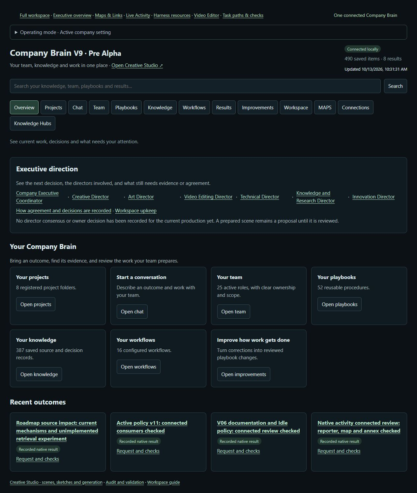
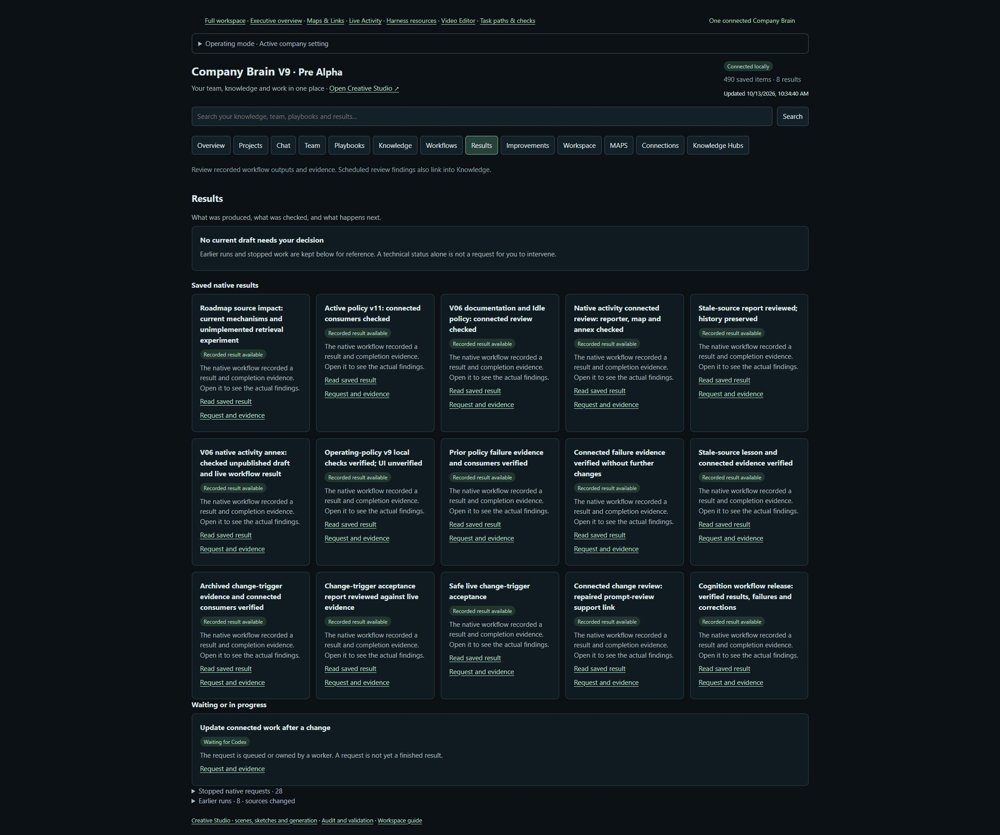

# Executive self-repair in Company Brain

Technical annex · 13 October 2026 · Draft for executive review and owner acceptance

## Purpose and evidence boundary

An executive review becomes useful when it can explain a deviation, assign its repair and show what changed. A dashboard saying that a routine is active cannot establish that the host will run it. A saved correction cannot establish that a later task benefits from it. Company Brain therefore needs a chain of evidence connecting the owner's objective, the actual operating state, a bounded intervention and an accepted result.

This annex describes that chain and the evidence available from the 13 October 2026 audit. It extends the Company Brain technical framework without revising its base thesis or combining it with the separate Architecture of Consent argument. Its audience is the human owner and the executive agents responsible for direction, review and accountable repair. “Self-repair” here means an authorized procedure that diagnoses a discrepancy and retains checked consequences. It does not imply unrestricted authority, continuous autonomous execution or demonstrated improvement in model capability.

The evidence comprises current operating contracts, a local audit and repair receipts, targeted checks, a bounded primary-source review and relevant sections of the framework PDF. Access to the source DOCX was denied. Readable PDF sections support the methodological discussion; equivalence with the DOCX and a complete visual audit of the base paper are unverified. Historical fixture results remain historical claims. The annex's proposed experiments have not been run.

## What the audit established

The audit inventoried 16 existing loops and seven host automation definitions. The operating policy requested Active at version 13, while all seven host definitions were PAUSED. Published loop metadata still described those schedules as ACTIVE. These are different surfaces with different responsibilities: task admission governs whether a participating request may proceed; host automation status determines whether a timer is enabled. A mode displayed by the dashboard does not itself change a host timer.

The observed discrepancy justified correcting metadata to match host readback. Seven expected-version saves produced repair receipts while preserving PAUSED host settings. Those receipts establish that scoped record changes were saved. They also carried navigation-map publication warnings, so they do not establish that every downstream projection refreshed successfully. The distinction matters because an executive decision based on the old display could mistake dormant routines for ongoing review coverage.

The initial test baseline passed 561 tests. The final backend suite passed 570 of 570 tests in 242.056 seconds, including eight loop-audit tests covering stale publication and the retained-text regression described below. Dashboard repairs made dispatcher guidance consider pause status, grouped completed and pending Results separately from collapsed failures, and included current completed native and local outputs on Overview while excluding explicitly stale records. Six targeted dashboard checks and 17 Node assertions passed. A browser reviewer then verified all three changes in rendered behavior, opened an actual output and its evidence, and expanded retained failure history. These changes help the owner locate usable outcomes and understand why automatic work is paused. They do not establish measured productivity gains.

The Results repair also exposed a deployment dependency: the gateway initially served a release copy of the Results script while the workspace overlay came from the canonical source. Source tests passed before the live Results view changed. Synchronizing the relevant release files made the repair visible; a fresh browser observation verified the new grouping without a backend reload. This is why acceptance must inspect the path the owner actually uses rather than infer deployment from an edited file.

A subsequent completion check reproduced a separate integration defect. The retained-text comparison rejected the Windows result because its line endings were CRLF while the archive represented the same text with LF. The repair normalizes CRLF only for this text comparison. Exact byte-hash checks still apply to artifacts, and other whitespace remains significant. Twenty targeted harness tests passed, including a regression for the observed mismatch. The existing run then completed against the same archive receipt, without replaying its work callback. Retained-result retrieval, search and reciprocal-link checks returned true. This establishes the checked completion chain for that run; it does not certify unrelated runs or the unresolved map refresh.

Several obligations remained open at the final evidence boundary. Running map publication used older pagination and reported a 63-line master index, while a calculation using current source predicted 58 map pages. This is a runtime/source discrepancy, not evidence of a refreshed shorter master. A proposed restart was blocked by policy, leaving live publication intermittently stale or delayed. A queued request containing 13 changed bindings was retained as failed at version 2 through an actual receipt, preserving its original bindings. A successor also became stale when an interface-loop dependency changed during the audit and required reconciliation. Stale attempts remain attributable history; the final outbox represents pending work, not a completed downstream review. No eligible scheduled end-to-end occurrence was established by this audit. An earlier intermittent test retry was not reproduced in the completed suite and is not claimed as a repaired defect.

| Evidence | What it establishes | What remains unestablished |
|---|---|---|
| Read-only loop and host inventory | Dated state and a metadata mismatch | A routine ran or completed |
| Seven metadata-save receipts | Scoped corrections reached canonical storage | Every published projection refreshed |
| Passing baseline and targeted checks | Checked mechanics under the exercised conditions | General executive judgment or productivity benefit |
| Reproduced line-ending defect and checked completion | Text comparison repair preserved byte-hash checks; the existing result completed without callback replay | Arbitrary content differences may be ignored or every run is certified |
| Dashboard repair and browser review | Pause-aware guidance, current output links and retained-history grouping are visible | Faster task completion or better executive judgment |
| Stale request and current outbox | A dependency change requires reconciliation | The next reviewer completed its work |

## Repair as an accountable chain

The practical unit of executive repair is one outcome with one accountable owner. Its input must identify the original request, relevant source versions, permitted paths, intended result and acceptance criteria. These bindings preserve meaning across handoffs and prevent a broad instruction such as “improve the Brain” from becoming authority to publish, enable providers or alter the owner's priorities.

A worker first compares expected behavior with an observation. System repair owns executable integration defects; prompt review owns procedure quality and transfer; interface review owns human usefulness; document upkeep owns checked supersession; executive review combines the findings with current direction and resource cost. Shared evidence can serve several reviews, but overlapping titles do not justify repeating effects or creating a competing claimant.

The repair owner then proposes the smallest intervention supported by the failure. A metadata mismatch calls for a metadata correction after fresh host readback. A confusing instruction calls for an observed wording or behavior repair. A failed unfamiliar task may warrant a candidate method and a reversible experiment. Each case needs its own acceptance evidence. A successful save, a model's confidence and a convincing explanation are insufficient substitutes for checking the affected state or artifact.

Current contracts limit native diagnosis to bounded attempts, normally two per failed step. A changed approach preserves the predecessor and remaining budget. If the effect may already have occurred, the next step reconciles the original identity and receipt before retrying. Replaying an uncertain mutation can produce duplicate work even when the second attempt looks successful. Terminal stale requests retain their failure reason; fresh scope follows current dependencies rather than rewriting the old request's history.

Acceptance and promotion are separate decisions. A checked local repair can be accepted for the current defect while its proposed general lesson remains a candidate. Promotion requires evidence that the lesson applies under stated prerequisites and survives counterexamples. The retained record must preserve the original failure, source versions, result and limits so a later task can judge applicability. Memory then supports accountable transfer rather than converting every plausible reflection into policy.

## How the existing loops contribute

The operating contract connects all 16 existing loops. Seven have host schedules; the others participate through explicit requests, source changes or outcome boundaries. This coverage is a procedural map, not a claim that 16 workers are continuously running. Existing time definitions and per-loop limits remain authoritative only alongside host readback and actual admission.

| Existing procedures | Contribution to the repair chain | Required return |
|---|---|---|
| Direction and ideas; executive improvement | Compare candidate changes with owner priorities | Sourced candidates and a dated keep, improve or defer decision |
| Interface usefulness; prompt workflow review; system bug repair | Locate human-flow, method and integration defects | Actual observations, bounded changes and checks |
| Document upkeep; reviewed naming | Preserve usable references and stable identity | Checked links or scoped naming outcome |
| Native dispatch; connected-change review | Own eligible requests and trace affected consumers | Current bindings, claimant and matching completion or failure |
| Source research; thinking intake | Resolve missing evidence and select a workable approach | Coverage, gaps and a checked scoped plan |
| Task harness; outcome learning | Check acceptance and preserve attributable consequences | Pass or gap; lesson with applicability and evidence |
| Living papers; research-to-document; evidence-to-reviewed-memory | Explain consequences and prepare reviewed artifacts | Actual artifact or candidate with checks and explicit status |

These handoffs make executive review more inspectable when participants follow the contracts. They do not intercept arbitrary host tools or guarantee that every configured caller complies. An absent tool, foreign claimant, changed source or incompatible operating state must remain a visible stop condition. Off blocks new work; Active permits authorized task work; autonomous maintenance requires Idle. The owner can therefore authorize a repair while existing timers remain paused, as in the observed audit.

## What current research contributes

Engineering guidance supports clear routing boundaries, concrete evaluator criteria and environmental checks. Anthropic's agent-pattern account recommends routing where categories can be reliably separated and evaluation where criteria are explicit. This supports testing route eligibility and acceptance rather than relying on semantic resemblance alone. It is vendor guidance, not evidence of Company Brain's effectiveness. [1]

Long-running-agent experience makes handoff state a consequential artifact. Progress records, version history and end-to-end checks can help the next session distinguish completed work from incomplete obligations. The 2025 harness account is focused on application development and leaves broader multi-agent advantage unresolved. Its useful implication for Company Brain is a testable requirement: a fresh session should reconstruct current state without guessing or duplicating effects. [2]

Additional reviewers incur cost and can still miss defects. A March 2026 application-development case study reports substantial cost differences across showcased approaches and describes evaluator calibration through human inspection. Its tasks and realized scope do not provide a controlled return-on-investment estimate. The appropriate local question is whether a particular reviewer reduces escaped defects and owner correction effort within equal scope and budgets. Existing mandatory checks should remain during such comparisons. [3]

Agent evaluation also separates a transcript from the environmental outcome. An agent reporting a completed action is evidence about its report; the relevant state establishes whether the action occurred. This distinction maps directly to Company Brain's separation of role configuration, invocation, checked output and retained consequence. [4]

Sun and colleagues report benchmark improvements from failure-driven inference-time interventions for computer-use agents. Their procedure involves human selection and verification, and its results concern the studied models and benchmark. It supports investigating targeted recovery changes without model-weight updates; it does not establish autonomous general repair or local productivity gains. The inspected paper license was CC BY-NC-ND 4.0, and no code or text was reused. [5]

SelfMem and RSIAgent are additional research leads, reviewed here only at abstract and metadata level. Their methods, budgets, contamination controls and code licenses were not substantively audited. They warrant bounded follow-up if an observed local failure makes them relevant. Their reported gains do not support this annex's efficacy claims. Public access also does not establish permission to reuse source code. [6, 7]

## Candidate evaluation program

The framework already proposes matched comparisons of essential task context, accepted factual memory, and facts plus validated procedures. It specifies frozen snapshots, development and held-out separation, randomized arm order, repeated trials, fixed budgets, source hashes and family-aware analysis. Executive self-repair should use that design rather than replace it with a favorable demonstration.

Five candidate experiments address the audit's practical uncertainties. First, interrupt an isolated handoff before an effect, after the effect but before its receipt, and after the receipt but before reporting. Check reconstruction, duplicate effects, false completion and recovery effort. Second, seed promotion cases that include an unsupported reflection, a valid narrow lesson with mismatched prerequisites, a superseded rule and an applicable procedure. Score rejection and stale-rule use separately.

Third, evaluate routing against a normal request, vague intent, matching keywords in the wrong project, a missing tool and a source changed after planning. Score preservation of owner meaning as well as route selection and accurate abstention. Fourth, compare existing worker checks with one additional artifact-focused reviewer for a reproduced failure family. Hold model, scope and total budget constant; count escaped defects, false positives, accepted work and human correction time.

Fifth, use disposable deterministic fixtures to compare recovery with and without one state-based warning and a fixed repair budget. Include repetitive non-progress, unavailable capability and stale writes. Grade outcome state and accurate stopping; avoid private reasoning traces. A small development pilot can establish feasibility and choose a meaningful improvement threshold. It is not confirmatory evidence. Online correction propagation must remain separate from frozen-memory evaluation so evaluation-derived lessons do not leak into held-out runs.

The decisive question is whether this coordination improves accepted outcomes and reduces repeated correction at an acceptable total cost. The present audit establishes discrepancies, scoped repairs and remaining integration obligations. It does not answer the productivity question. The executive's next decision can therefore preserve the checked repairs, assign unresolved publication and request ownership, and select a small experiment when admission and priorities permit. That decision remains accountable to the owner's objective and to observed results.

## Public source references

1. Anthropic. *Building effective agents*. 19 December 2024; accessed 13 October 2026. https://www.anthropic.com/engineering/building-effective-agents
2. Anthropic. *Effective harnesses for long-running agents*. 26 November 2025; accessed 13 October 2026. https://www.anthropic.com/engineering/effective-harnesses-for-long-running-agents
3. Anthropic. *Harness design for long-running application development*. 24 March 2026; selected sections accessed 13 October 2026. https://www.anthropic.com/engineering/harness-design-long-running-apps
4. Anthropic. *Demystifying evals for AI agents*. 9 January 2026; selected sections accessed 13 October 2026. https://www.anthropic.com/engineering/demystifying-evals-for-ai-agents
5. Sun et al. *Learning from Failure: Inference-Time Self-Improvement for Computer-Use Agents*. arXiv v1, 30 June 2026. Main sections inspected; appendices and code not audited. https://arxiv.org/html/2606.31270v1
6. Yang et al. *SelfMem: Self-Optimizing Memory for AI Agents*. arXiv v1, 4 July 2026. Abstract and metadata only. https://arxiv.org/abs/2607.03726v1
7. Zhu et al. *RSIAgent: Autonomous Exploration for Recursive Self-improvement in New Environments*. arXiv v2, 18 September 2026. Abstract and metadata only. https://arxiv.org/abs/2609.15364v2

## Observed interface evidence

Figure 1. Overview after repair, 13 October 2026, approximately 10:31 London. Read the bottom “Recent outcomes” row: titles now link to recorded native results, with separate “Request and checks” links. The reviewer opened the roadmap result and observed its substantive Knowledge record, limits and version history. The explicit absence of a recorded director decision remains visible above. These are output-navigation observations, not proof of director consensus or task benefit. Screenshot retained unchanged; counts are capture-time state.

Figure 2. Results after release-file synchronization and display-name refinement, approximately 10:34 London. Read the sections in order: “Saved native results” uses actual output titles and links; “Waiting or in progress” states that a request is unfinished; the bottom disclosures retain 28 stopped native requests and eight earlier source-changed runs. Browser review confirmed the named results, opened request evidence and expanded stopped history to confirm preserved failure reasons and links. Grouping changes access to evidence without deleting it. Screenshot retained unchanged; it does not certify the underlying outcomes beyond their named checks.
